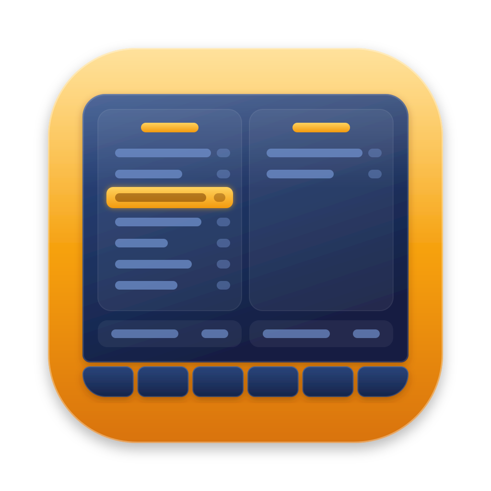
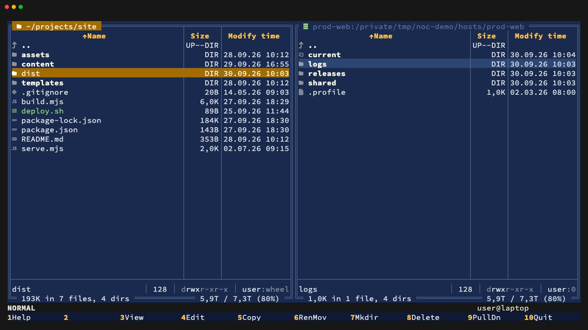
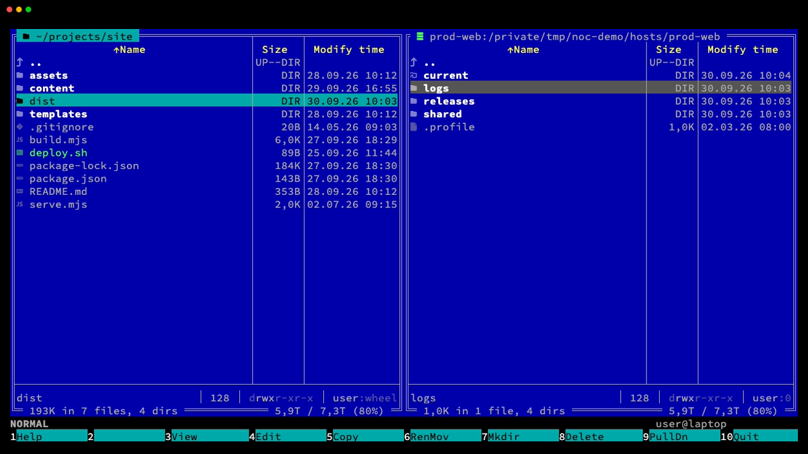

# Noon Commander



A two-panel terminal file manager for macOS and Linux, written in Rust, where SFTP hosts work just like the local disk. The command is `noc`.

> **Status: pre-alpha.** Browsing, copying, moving, deleting, viewing, and editing work, locally and over SFTP; polish comes next. See the [roadmap](docs/roadmap.md).

<br clear="right">





## Features

- **Vim's keys, mc's F-keys.** Normal, Insert, and Visual mode down to the text fields, with motions, operators, counts, and registers.
- **Local and SFTP alike.** F5, F6, and F8 copy, move, and delete between your machine and a host, or between two hosts, with progress and cancellation; long jobs go to the background (`f j`).
- **Your `~/.ssh/config` just works.** Noon Commander runs your `ssh`, so `ProxyJump`, `Match`, `Include`, agents, FIDO keys, certificates, and `known_hosts` behave as in your terminal. One login per host serves every panel and transfer; password, OTP, and host-key prompts show in the TUI.
- **Location menu.** `g l` lists the mounted volumes and all hosts of your ssh config, the ones used last first, with a filter.
- **Tabs and workspaces.** Each panel has its own tabs (`t n`, `t c`, `g t`, `g T`); `t W` saves the tabs of both panels under a name, `t w` brings them back.
- **zoxide.** `g z` jumps to the directories [zoxide](https://github.com/ajeetdsouza/zoxide) ranks; those you work in from Noon Commander count too.
- **Search in a tree.** `f /` finds text with [ripgrep](https://github.com/BurntSushi/ripgrep) as you type, `f f` names with [fd](https://github.com/sharkdp/fd), on hosts too; F3 and F4 open a file at the line.
- **Fuzzy filters.** Quick search and every list match as fzf does (`cfg` finds `config.rs`); Ctrl+s switches to plain text, glob, or a regular expression, and sets the case.
- **Viewer and editor.** F3 reads large files in parts, on hosts too, and `F` follows a growing file; F4 opens `$EDITOR`, on a local copy for a remote file.
- **Shell command line.** `!` runs a command in the panel's directory, on a host too, with the aliases of your shell; `g <` shows the output.
- **Checksums.** `f #`: SHA-256, SHA-512, SHA-1, MD5, and BLAKE3 of files and trees, compared with an expected value or the file in the other panel.
- **Looks.** Themes `mc-classic`, `terminal`, `noon-dark`, `noon-light`, `catppuccin-mocha`, and `catppuccin-latte`; Nerd Font icons; the mouse.

## Philosophy

- Local and remote files are equally first-class. SFTP comes first; more backends may follow.
- The system OpenSSH client is the single source of truth for connections and authentication. Noon Commander links no SSH library and stores no passwords.
- Port, agent, X11, and tunnel forwarding are always off, whatever the ssh config says ([ADR 0062](docs/adr/0062-forwarding-is-never-allowed.md)); SFTP channels get the safety options of the stock `sftp(1)`.
- The UI never waits on the network: every remote operation is asynchronous, cancellable, and shows progress.

Non-goals: forwarding of any kind, a built-in SSH implementation, a password manager, editing `~/.ssh/config` or `known_hosts`.

## Requirements

- macOS, or Linux on x86-64 or 64-bit ARM.
- OpenSSH 8.7 or newer (`ssh -V`).
- A [Nerd Font](https://www.nerdfonts.com) in the terminal for the icons; without one, set `icons = false` under `[ui]`.
- Optional:
  - ripgrep for `f /`, locally and on the hosts searched;
  - fd for `f f`, locally and on the hosts searched;
  - zoxide for `g z`.

## Installing

```sh
# macOS, Homebrew
brew install noon-commander/tap/noon-commander

# Arch Linux, AUR: with paru, yay, or pikaur
paru -S noon-commander
yay -S noon-commander
pikaur -S noon-commander
```

The AUR also has `noon-commander-bin` (the release binary) and `noon-commander-git` (the latest commit).

The [releases](https://github.com/noon-commander/noon-commander/releases) have tarballs for Apple Silicon and Intel Macs and static Linux binaries for x86-64 and 64-bit ARM, with build provenance attestations ([checking a download](packaging/README.md#checking-a-download)). The macOS binaries are not notarized: after a download with a browser, run `xattr -d com.apple.quarantine noc`.

## Development

Needs Rust 1.100 or newer ([rustup](https://rustup.rs)), [just](https://github.com/casey/just), and a C toolchain for linking: `xcode-select --install` on macOS, `build-essential` (Debian, Ubuntu) or `base-devel` (Arch) on Linux.

```sh
git clone https://github.com/noon-commander/noon-commander.git
cd noon-commander
just build-release    # ./target/release/noc
just run              # a debug build; arguments go to noc
```

The project is managed through [`just`](justfile) ([ADR 0013](docs/adr/0013-just-task-runner.md)), and CI runs the same recipes. Run `just --list` to see all of them; `just ci` must pass before a commit. The other tools they need:

```sh
brew install rumdl taplo shellcheck shfmt actionlint zizmor cargo-shear cargo-deny \
    cargo-insta cargo-edit resvg vhs
# or, on any platform (ShellCheck, ttyd, and ffmpeg from your package manager):
cargo install rumdl taplo-cli zizmor cargo-shear cargo-deny cargo-insta cargo-edit resvg \
    --locked
go install github.com/rhysd/actionlint/cmd/actionlint@latest
go install mvdan.cc/sh/v3/cmd/shfmt@latest
go install github.com/charmbracelet/vhs@latest
```

VHS is needed only for `just render-screenshots`, with ttyd, ffmpeg, and a [Nerd Font](https://www.nerdfonts.com).

The SFTP tests run against the local `sftp-server` over pipes, with no network and no real `ssh`. If it is not in a standard location, set `SFTP_SERVER` to its path; otherwise those tests are skipped.

`noc debug version` prints what a bug report needs, one `key value` line per fact ([details](docs/architecture.md#command-line)).

## Configuration

Configuration lives in `~/.config/noc/`, following the XDG layout on macOS too. `noc config init` writes the commented defaults; `noc config paths` shows every file and directory in use.

### The Option key on macOS

Alt and the highlighted letter pick a command of the pull-down menu or a control of a dialog; in Insert mode, Visual mode, and the panels, Alt and a key also stand for Esc and the key, as in vim. On macOS the Option key types characters such as `ø` instead, unless the terminal sends it as Alt:

- Terminal.app: Settings → Profiles → Keyboard → Use Option as Meta key.
- iTerm2: Settings → Profiles → Keys → Left Option key: Esc+.
- Ghostty: `macos-option-as-alt = true`.
- kitty: `macos_option_as_alt yes`.
- Alacritty: `option_as_alt = "Both"` under `[window]`.

Without it, the arrows and Enter run the commands of the pull-down menu and press the buttons of dialogs.

## Contributing

See [AGENTS.md](AGENTS.md) for the project rules, layout, and commands. They apply to humans and AI agents alike.

## License

[GPL-3.0-or-later](LICENSE)
